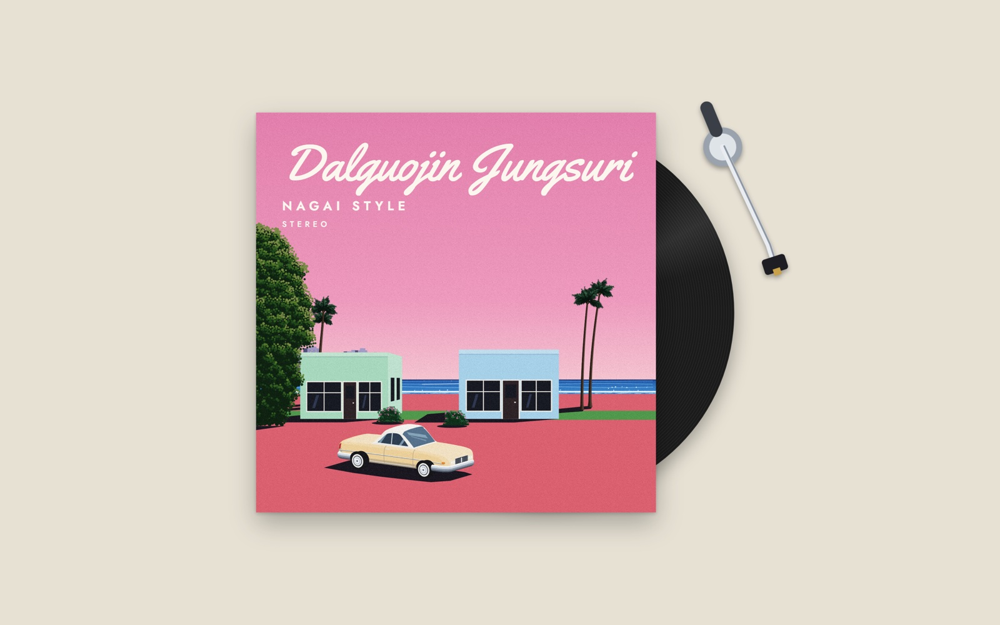
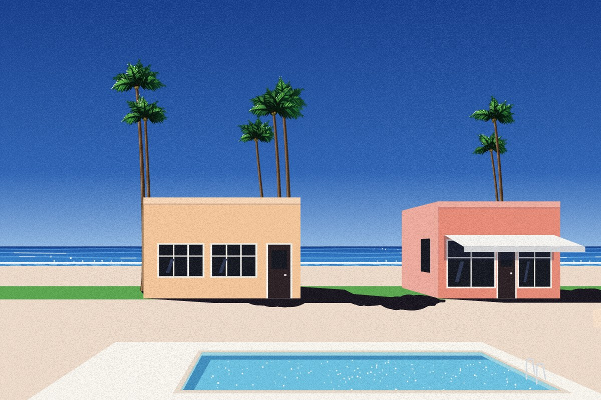
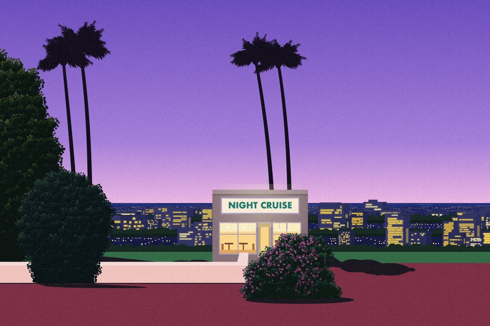
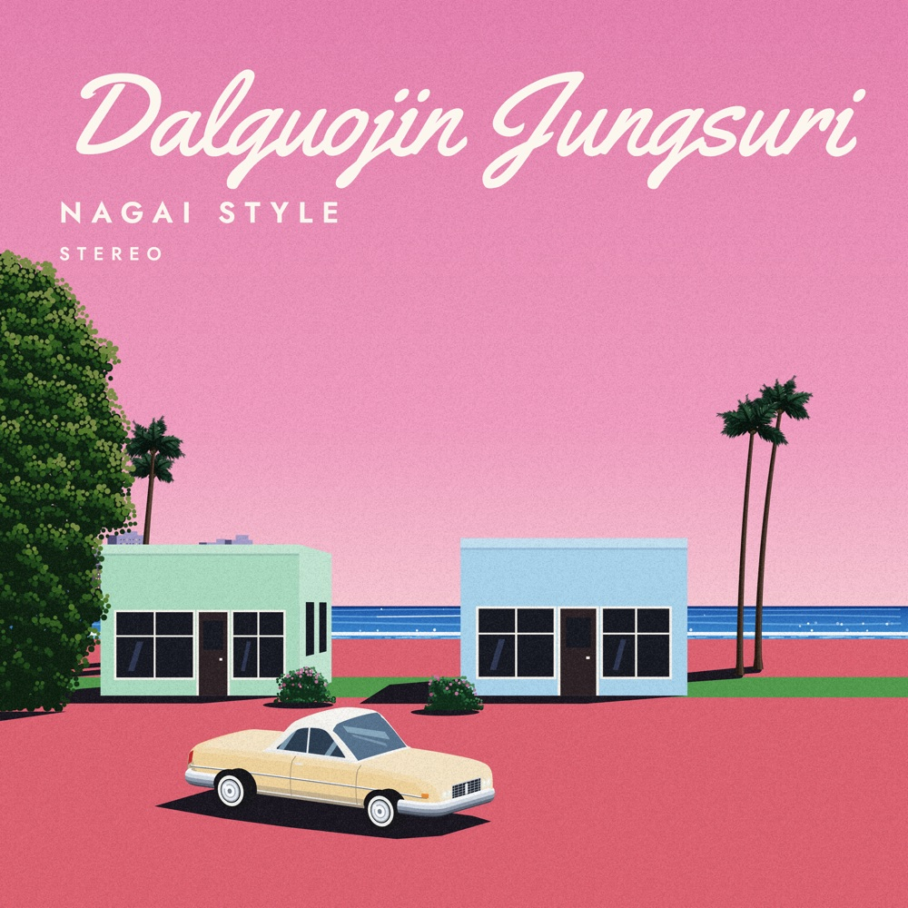
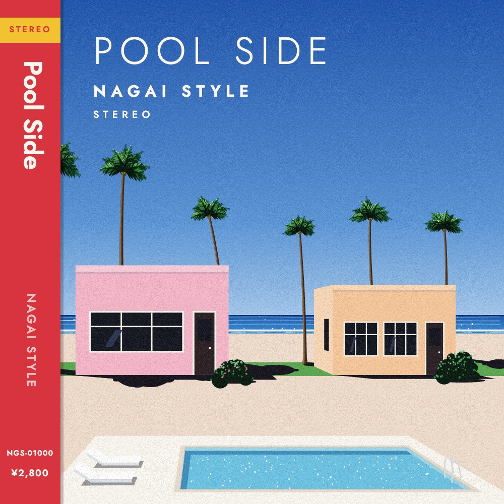
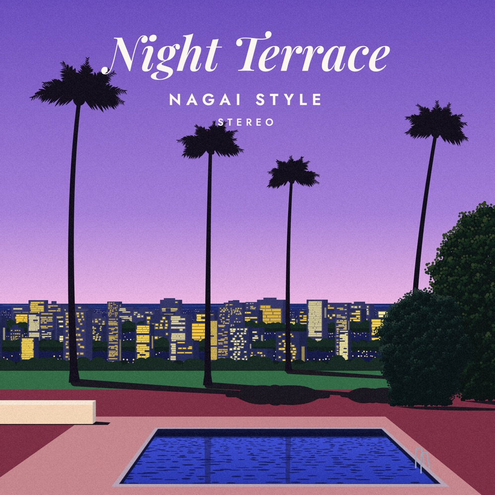
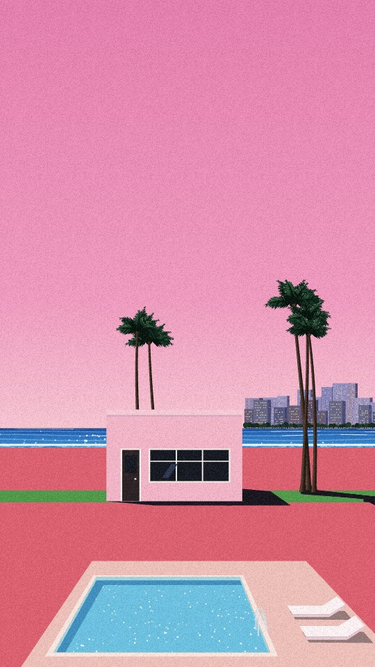

# Nagai Style

[English](README.md) · **한국어**

히로시 나가이(永井博) 화풍의 80년대 시티팝 장면을 절차적으로 만들고, 은은하게 움직이게 합니다. 바람에 흔들리는 야자수, 바다와 수영장의 윤슬, 납작한 파스텔 건물과 길고 진한 그림자. 모든 장면은 시드와 구도 결정트리로 만들어지므로 끝없이 다양하고, 어떤 장면이든 공유하거나 그대로 다시 만들 수 있습니다.

이 저장소에는 세 가지가 들어 있습니다.

- **웹사이트** — [nagai-style.vercel.app](https://nagai-style.vercel.app): 장면을 둘러보고, 링크로 공유하고, 고해상도 PNG 로 저장합니다.
- **앨범 커버 생성기** — [nagai-style.vercel.app/cover](https://nagai-style.vercel.app/cover/): 정사각 장면에 제목을 얹고, 일본 LP 띠지(오비)를 두르고, 레코드를 틀어 보고, 3000×3000 으로 저장합니다.
- **Claude 스킬** — `nagai-motion`: Claude 에게 "나가이 히로시 풍으로 해질녘 수영장 리조트" 라고 하면 움직이는 HTML 페이지 하나를 만들어 줍니다.



| 오후 | 해질녘 | 저녁 |
|---|---|---|
|  |  |  |

| 앨범 커버 | | | 모바일 (9:16) |
|---|---|---|---|
|  |  |  |  |

## 기능

- **구도 결정트리.** 테마(해변, 리조트, 수영장 마당, 해안 도로), 먼 풍경(바다, 빌딩숲, 섬, 생울타리), 주인공 위치, 전경(수영장, 자동차, 담장), 야자수, 하늘(짙은 파랑, 맑은 오후, 분홍 해질녘, 연보라 저녁). 원하는 것만 고정하고 나머지는 시드에 맡깁니다.
- **식물.** 야자수와 꽃 덤불(꽃 색은 장면마다 분홍·빨강·흰색·노랑·보라)에 더해 잎 점으로 덮인 둥근 나무(녹색·청록·연두), 용설란·유카, 수영장 가 화분.
- **하나의 빛, 하나의 화풍.** 모든 객체가 같은 빛과 그림자, 단계로 끊은 납작한 음영, 한 점 투시를 따르므로 장면이 늘 어울립니다.
- **움직임.** 야자수의 바람, 부서지는 파도, 물 위의 반짝임. 초당 30번만 그리고 화면 밖에서는 멈춰서 배터리에 부담이 적습니다.
- **장면 코드.** 장면 하나가 `83608-12 9:16 sky:violet` 같은 한 줄입니다. 시드 칸에 붙여넣거나 `…/#nagai=83608-12` 주소로 열면 똑같은 장면이 나옵니다.
- **가로·세로·정사각.** 3:2, 9:16(폰 배경화면), 1:1(앨범 커버) 마다 구도를 새로 짭니다.
- **고해상도 저장.** 2400×1600, 1440×2560, 3000×3000 PNG. 그레인은 화면에서 보던 결 그대로 저장됩니다.
- **앨범 커버 생성기.** 필기체·모던·세리프 글꼴, 일본 LP 띠지, 레코드 슬리브 목업, 톤암이 있는 레코드 플레이어(선택).
- **한국어 / 영어.** 두 페이지 모두 브라우저 언어로 시작하고 한 / EN 전환 버튼이 있습니다 (`?lang=en` / `?lang=ko` 주소도 됨).
- **의존성 없음.** 자바스크립트 파일 하나(압축본 약 96 KB), 순수 Canvas 2D.

## Claude 에서 쓰기

### Claude Code (플러그인)

```text
/plugin marketplace add doongchoong/nagai-style
/plugin install nagai-motion@nagai-style
```

### Claude Code (폴더 복사)

```bash
git clone https://github.com/doongchoong/nagai-style.git
cp -r nagai-style/skills/nagai-motion ~/.claude/skills/       # 모든 프로젝트에서
# 또는: cp -r nagai-style/skills/nagai-motion .claude/skills/  # 이 프로젝트에서만
```

### claude.ai

[`dist/nagai-motion.skill`](dist/nagai-motion.skill) (스킬 폴더를 묶은 zip) 을 **설정 → 기능(Capabilities) → 스킬** 에서 올립니다.

그다음 이렇게 부탁하면 됩니다.

> 나가이 히로시 풍으로 해질녘 수영장 리조트, 모바일 배경화면으로 만들어줘.
> Make a Hiroshi Nagai style dusk resort with a pool, as a phone wallpaper.

더 많은 요청 예시와 모든 옵션은 [docs/USAGE.ko.md](docs/USAGE.ko.md) 에 있습니다.

## 라이브러리 바로 쓰기

```html
<canvas id="art"></canvas>
<div id="art-ctl"></div>
<script src="https://cdn.jsdelivr.net/gh/doongchoong/nagai-style@main/skills/nagai-motion/assets/nagai-scene.min.js"></script>
<script>
  NagaiScene.mount({ canvas: '#art', controls: '#art-ctl', seed: 42, force: { theme: 'resort', sky: 'dusk' } });
</script>
```

속성만으로도 됩니다.

```html
<canvas data-nagai data-seed="42" data-aspect="9:16" data-force='{"sky":"violet"}' data-controls></canvas>
```

mount 옵션, 컨트롤, 장면 코드, 새 객체 추가 같은 전체 API 는 [docs/USAGE.ko.md](docs/USAGE.ko.md#라이브러리) 에 있습니다.

## 저장소 구조

```
skills/nagai-motion/      Claude 스킬 (원본)
  SKILL.md                Claude 가 따르는 작업 지침
  assets/                 nagai-scene.js, nagai-scene.min.js, cover.html
  references/             Claude 가 읽는 API·화풍 문서
  scripts/build_page.py   config.json → HTML 페이지 하나
index.html, cover/        웹사이트 (site.config.json, cover.config.json 으로 빌드)
.claude-plugin/           Claude Code 플러그인 마켓플레이스 등록 정보
dist/                     claude.ai 용 스킬 패키지
docs/                     사용법과 README 그림
```

`./build.sh` 는 스킬에서 두 페이지를 다시 만들고, `./pack.sh` 는 `dist/nagai-motion.skill` 을 다시 묶습니다. 사이트는 Vercel 에 정적 파일로 배포되며, `.vercelignore` 가 스킬·문서·빌드 재료를 배포에서 뺍니다.

## 참고

- 히로시 나가이 그림의 분위기에 바치는 팬 오마주입니다. 히로시 나가이와 관계가 없고 승인받은 것도 아니며, 그의 작품이나 실제 앨범 커버를 재현하지 않습니다. 모든 장면은 새로 만들어집니다.
- 자동차는 특정 차종·브랜드가 아닌 일반형(쿠페, 컨버터블, 각진 세단)입니다.

## 라이선스

- 코드·스킬·문서: [MIT](LICENSE).
- `cover/` 의 곡 "달궈진 정수리" (Google Gemini 로 제작): [CC0 1.0](cover/MUSIC-LICENSE.md) — 누구나 어떤 용도로든 자유롭게, 출처 표기 없이 쓸 수 있습니다.
